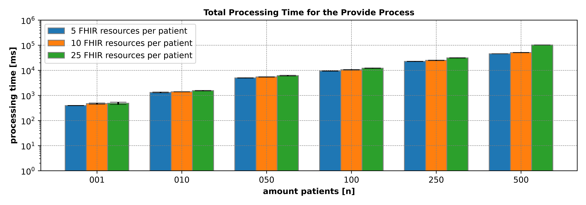
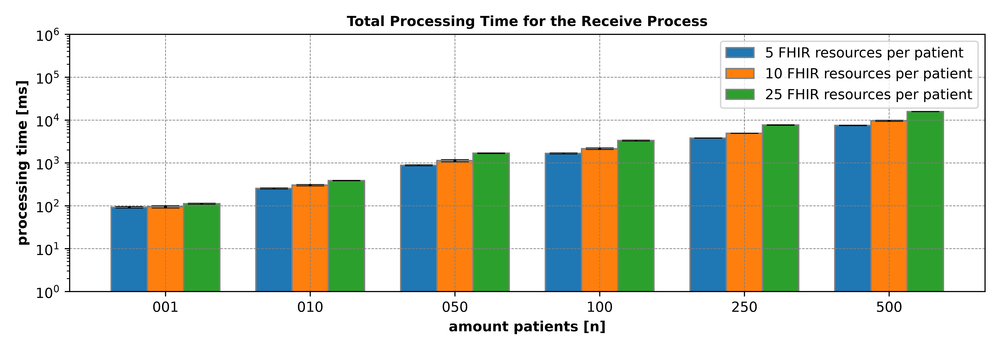

# Results

In this repository the results of the time evaluation of the EyeMatics DSF process plugin are listed. Results were conducted through the variation of the number of patients and resources (see also [here](https://github.com/prus-springsteen/eyematics-dsf-process-plugin-time-test/blob/main/eyematics-dsf-process-plugin-test-data-generator/src/main/java/org/eyematics/process/tools/generator/FHIRResourceGenerator.java)).
Time measurements are in milliseconds [ms]. The class TimeMeasurements is used to measure the time of the different tasks (see also here).

Raw data can be found in the folder `src\raw`.

## Provide: A graphical overview

## Provide: A detailed overview

|    |   patients |   resources | ReadPatientDataTask (mean) | ReadPatientDataTask (std) |   ReadConsentDataTask (mean) | ReadConsentDataTask (std) | ProcessGlobalPseudonymTask (mean) |   ProcessGlobalPseudonymTask (std) | ReadMedicalDataTask (mean) | ReadMedicalDataTask (std) | CheckConsentMedicalDataTask (mean) | CheckConsentMedicalDataTask (std) | PseudonymizeDataTask (mean) | PseudonymizeDataTask (std) | CreateDataBundlesTask (mean) | CreateDataBundlesTask (std) | EncryptDataBundleTask (mean) | EncryptDataBundleTask (std) | StoreProvideDataTask (mean) | StoreProvideDataTask (std) | total (mean) | total (std) |
|---:|-----------:|------------:|---------------------------:|--------------------------:|-----------------------------:|--------------------------:|----------------------------------:|-----------------------------------:|---------------------------:|--------------------------:|-----------------------------------:|----------------------------------:|----------------------------:|---------------------------:|-----------------------------:|----------------------------:|-----------------------------:|----------------------------:|----------------------------:|---------------------------:|-------------:|------------:|
|  0 |       0001 |          05 |                      21.62 |                      3.07 |                        37.88 |                      6.37 |                              2.94 |                               0.9  |                     197.32 |                      4.65 |                               4.40 |                              0.67 |                       19.78 |                       4.00 |                         4.37 |                        0.30 |                        52.00 |                        6.19 |                       54.89 |                      10.06 |       395.20 |        7.44 |
|  1 |       0001 |          10 |                      26.31 |                      3.98 |                        35.16 |                      2.17 |                              3.28 |                               0.8  |                     233.47 |                     36.94 |                               8.35 |                              2.08 |                       19.10 |                       1.72 |                         7.41 |                        4.30 |                        72.20 |                       18.24 |                       67.66 |                      11.81 |       472.94 |       27.44 |
|  2 |       0001 |          25 |                      21.52 |                      0.60 |                        41.98 |                      2.47 |                              4.26 |                               0.71 |                     233.82 |                     23.95 |                              14.13 |                              1.76 |                       31.58 |                       9.77 |                         8.73 |                        2.70 |                        59.95 |                        8.58 |                       73.21 |                      17.26 |       489.18 |       53.24 |
|  3 |       0010 |          05 |                      18.15 |                      3.36 |                       139.37 |                     25.44 |                              5.72 |                               1.26 |                     970.54 |                     19.58 |                              13.21 |                              0.33 |                       26.74 |                       1.36 |                        13.60 |                        2.48 |                        62.69 |                        5.85 |                       68.06 |                       7.80 |      1318.08 |       53.35 |
|  4 |       0010 |          10 |                      20.57 |                      1.44 |                       156.18 |                     23.21 |                             10.75 |                               5.36 |                    1009.61 |                     24.16 |                              17.07 |                              0.67 |                       31.97 |                       5.79 |                        19.51 |                        3.29 |                        63.49 |                        4.06 |                       67.47 |                      10.58 |      1396.63 |       15.54 |
|  5 |       0010 |          25 |                      19.30 |                      1.16 |                       167.58 |                     37.61 |                             12.46 |                               1.44 |                    1085.59 |                     35.02 |                              31.39 |                              2.05 |                       43.21 |                       4.31 |                        31.29 |                        2.43 |                        79.14 |                        7.60 |                       83.84 |                      14.89 |      1553.80 |       47.40 |
|  6 |       0050 |          05 |                      19.17 |                      0.94 |                       688.16 |                    100.45 |                              8.33 |                               0.61 |                    3953.39 |                     19.77 |                              49.48 |                              0.87 |                       63.86 |                       2.42 |                        49.86 |                        3.22 |                        78.42 |                        2.15 |                       86.86 |                      20.22 |      4997.54 |      111.35 |
|  7 |       0050 |          10 |                      21.40 |                      2.66 |                       781.16 |                     91.59 |                             20.83 |                              17.72 |                    4157.09 |                     31.09 |                              79.39 |                              8.68 |                       77.39 |                       3.18 |                       104.84 |                       52.76 |                       110.50 |                        5.37 |                      102.08 |                      12.99 |      5454.66 |      122.49 |
|  8 |       0050 |          25 |                      22.87 |                      2.94 |                       724.66 |                     31.73 |                             19.54 |                               0.82 |                    4518.01 |                     81.72 |                             154.35 |                             10.93 |                      214.16 |                     135.99 |                       147.62 |                        9.04 |                       187.20 |                       17.70 |                      160.10 |                       6.82 |      6148.51 |      237.73 |
|  9 |       0100 |          05 |                      27.37 |                      2.91 |                      1169.07 |                    166.65 |                             13.49 |                               0.54 |                    7657.69 |                     32.04 |                              95.30 |                              7.40 |                      100.25 |                       1.71 |                        84.40 |                        0.99 |                       121.36 |                        4.88 |                      151.44 |                      30.56 |      9420.37 |      207.47 |
| 10 |       0100 |          10 |                      36.41 |                     23.94 |                      1422.34 |                    106.46 |                             23.14 |                               6.87 |                    8321.83 |                    231.52 |                             151.36 |                              4.98 |                      147.89 |                       1.89 |                       115.93 |                        9.17 |                       180.54 |                        8.99 |                      185.12 |                      11.64 |     10584.50 |      295.58 |
| 11 |       0100 |          25 |                      29.53 |                      3.41 |                      1555.47 |                    211.87 |                             29.99 |                               1.15 |                    9043.30 |                     79.81 |                             294.30 |                              9.29 |                      259.73 |                       9.37 |                       277.02 |                       10.37 |                       347.69 |                       53.09 |                      359.03 |                      63.96 |     12196.00 |      298.52 |
| 12 |       0250 |          05 |                      61.29 |                      6.70 |                      3079.39 |                    514.51 |                             29.01 |                               2.15 |                   18401.90 |                    242.18 |                             218.48 |                              1.64 |                      208.19 |                       8.84 |                       161.99 |                        2.49 |                       251.94 |                       23.52 |                      283.95 |                      33.11 |     22696.20 |      486.18 |
| 13 |       0250 |          10 |                      61.65 |                      7.37 |                      2995.54 |                    903.95 |                             41.80 |                               3.9  |                   20186.50 |                    275.51 |                             340.46 |                              9.14 |                      310.93 |                       7.43 |                       275.67 |                       12.59 |                       384.65 |                       18.57 |                      381.48 |                       12.4 |     24978.70 |      714.91 |
| 14 |       0250 |          25 |                      72.51 |                     14.69 |                      4371.09 |                    350.16 |                             70.93 |                               1.22 |                   23209.20 |                    338.20 |                             708.98 |                             13.57 |                      626.35 |                     116.77 |                       779.29 |                       97.84 |                       837.96 |                       19.02 |                      662.24 |                      14.43 |     31338.60 |      679.79 |
| 15 |       0500 |          05 |                     160.25 |                    105.41 |                      4396.33 |                    120.36 |                             57.45 |                               4.77 |                   38929.80 |                    166.82 |                             424.32 |                             10.65 |                      377.74 |                      15.50 |                       345.93 |                        9.55 |                       397.57 |                        3.77 |                      647.29 |                     159.04 |     45736.70 |      222.18 |
| 16 |       0500 |          10 |                     100.93 |                     21.16 |                      5337.01 |                    990.10 |                             82.51 |                               5.49 |                   41850.50 |                    160.83 |                             688.73 |                             12.12 |                      554.47 |                      15.41 |                       655.63 |                       97.40 |                       784.90 |                       75.70 |                      918.67 |                     186.44 |     50973.40 |     1100.24 |
| 17 |       0500 |          25 |                     108.60 |                      3.94 |                      8887.95 |                    719.82 |                            154.42 |                              20.97 |                   81541.00 |                    921.95 |                            4585.83 |                              49.5 |                     1277.47 |                     161.63 |                      2117.66 |                      393.68 |                      2376.03 |                      236.38 |                     1356.32 |                     181.92 |    102405.00 |      426.54 |

## Provide: http vs. bpe

The following tasks belong to http:     ReadPatientDataTask, ReadConsentDataTask, ProcessGlobalPseudonymTask, ReadMedicalDataTask, StoreProvideDataTask\
The following tasks belong to bpe:      CheckConsentMedicalDataTask, PseudonymizeDataTask, CreateDataBundlesTask, EncryptDataBundleTask

|    |   patients |   resources | http (mean) | http (std) | bpe (mean) | bpe (std) | total (mean) | total (std) |
|---:|-----------:|------------:|------------:|-----------:|-----------:|----------:|-------------:|------------:|
|  0 |       0001 |          05 |      314.65 |       5.22 |      80.55 |     10.65 |       395.20 |        7.44 |
|  1 |       0001 |          10 |      365.88 |      33.72 |     107.06 |     23.27 |       472.94 |       27.44 |
|  2 |       0001 |          25 |      374.78 |      41.95 |     114.39 |     18.32 |       489.18 |       53.24 |
|  3 |       0010 |          05 |     1201.84 |      53.64 |     116.24 |      4.60 |      1318.08 |       53.35 |
|  4 |       0010 |          10 |     1264.59 |      13.08 |     132.03 |      7.49 |      1396.63 |       15.54 |
|  5 |       0010 |          25 |     1368.77 |      46.38 |     185.04 |      5.49 |      1553.80 |       47.40 |
|  6 |       0050 |          05 |     4755.91 |     109.88 |     241.63 |      1.92 |      4997.54 |      111.35 |
|  7 |       0050 |          10 |     5082.55 |      83.24 |     372.11 |     57.46 |      5454.66 |      122.49 |
|  8 |       0050 |          25 |     5445.19 |      88.70 |     703.32 |    160.61 |      6148.51 |      237.73 |
|  9 |       0100 |          05 |     9019.06 |     199.67 |     401.31 |     11.67 |      9420.37 |      207.47 |
| 10 |       0100 |          10 |     9988.83 |     285.82 |     595.72 |     16.55 |     10584.50 |      295.58 |
| 11 |       0100 |          25 |    11017.30 |     253.35 |    1178.74 |     54.87 |        12196 |      298.52 |
| 12 |       0250 |          05 |    21855.60 |     472.84 |     840.60 |     18.77 |     22696.20 |      486.18 |
| 13 |       0250 |          10 |    23667.00 |     709.84 |    1311.71 |      7.41 |     24978.70 |      714.91 |
| 14 |       0250 |          25 |    28386.00 |     690.25 |    2952.57 |     10.48 |     31338.60 |      679.79 |
| 15 |       0500 |          05 |    44191.20 |     250.55 |    1545.57 |     31.71 |     45736.70 |      222.18 |
| 16 |       0500 |          10 |    48289.60 |    1038.48 |    2683.73 |     81.18 |     50973.40 |     1100.24 |
| 17 |       0500 |          25 |    92048.30 |     801.52 |   10357.00 |    397.99 |    102405.00 |      426.54 |

## Receive: A graphical overview

## Receive: A detailed overview 

|    |   patients |   resources |   DownloadRequestedDataTask (mean) | DownloadRequestedDataTask (std) |   DecryptRequestedDataTask (mean) | DecryptRequestedDataTask (std) | InsertRequestedDataTask (mean) | InsertRequestedDataTask (std) | total (mean) | total (std) |
|---:|-----------:|------------:|-----------------------------------:|--------------------------------:|----------------------------------:|-------------------------------:|-------------------------------:|------------------------------:|-------------:|------------:|
|  0 |       0001 |          05 |                              16.66 |                            2.94 |                             33.14 |                           1.19 |                          42.19 |                          2.65 |        91.99 |        3.94 |
|  1 |       0001 |          10 |                              14.16 |                            0.99 |                             35.06 |                           2.67 |                          45.69 |                          2.52 |        94.91 |        6.08 |
|  2 |       0001 |          25 |                              19.21 |                            1.14 |                             38.73 |                           3.00 |                          53.96 |                          2.27 |       111.90 |        3.40 |
|  3 |       0010 |          05 |                              23.71 |                            0.53 |                             43.07 |                           1.41 |                         187.30 |                          7.44 |       254.08 |        8.45 |
|  4 |       0010 |          10 |                              35.62 |                            1.06 |                             59.58 |                           5.64 |                         207.94 |                         12.73 |       303.14 |       12.99 |
|  5 |       0010 |          25 |                              63.55 |                            1.23 |                             89.25 |                           2.69 |                         234.41 |                          5.87 |       387.21 |        4.77 |
|  6 |       0050 |          05 |                              72.45 |                            5.07 |                            102.78 |                           2.28 |                         705.35 |                         19.37 |       880.59 |       26.32 |
|  7 |       0050 |          10 |                             131.87 |                            2.63 |                            167.16 |                           0.95 |                         831.26 |                         72.65 |      1130.28 |       70.77 |
|  8 |       0050 |          25 |                             304.02 |                           12.29 |                            413.94 |                          37.62 |                         967.78 |                         25.95 |      1685.73 |       35.69 |
|  9 |       0100 |          05 |                             137.43 |                            9.05 |                            223.37 |                          13.32 |                        1309.02 |                         47.69 |      1669.82 |       54.12 |
| 10 |       0100 |          10 |                             270.69 |                           10.69 |                            415.18 |                          31.22 |                        1464.01 |                         66.90 |      2149.88 |       99.45 |
| 11 |       0100 |          25 |                             587.06 |                           23.62 |                            912.57 |                          31.33 |                        1832.07 |                         57.17 |      3331.69 |       99.54 |
| 12 |       0250 |          05 |                             324.67 |                            6.21 |                            478.14 |                          12.92 |                        2999.78 |                         46.25 |      3802.59 |       35.29 |
| 13 |       0250 |          10 |                             572.08 |                           17.88 |                            909.46 |                          16.04 |                        3424.07 |                         46.39 |      4905.61 |       22.44 |
| 14 |       0250 |          25 |                            1343.35 |                           44.83 |                           2052.48 |                          62.03 |                        4260.69 |                        147.86 |      7656.52 |      130.93 |
| 15 |       0500 |          05 |                             628.79 |                           10.59 |                            976.08 |                          32.31 |                        5898.14 |                         75.46 |      7503.00 |      113.69 |
| 16 |       0500 |          10 |                            1112.51 |                           10.10 |                           1879.62 |                         242.24 |                        6600.01 |                        103.86 |      9592.14 |      308.22 |
| 17 |       0500 |          25 |                            2916.74 |                           69.08 |                           4400.54 |                         170.11 |                        8472.68 |                        131.19 |     15790.00 |      154.63 |

## Receive: http vs. bpe

The following tasks belong to http:     DownloadRequestedDataTask, InsertRequestedDataTask\
The following tasks belong to bpe:      DecryptRequestedDataTask

|    |   patients |   resources | http (mean) |   http (std) |   bpe (mean) | bpe (std) | total (mean) | total (std) |
|---:|-----------:|------------:|------------:|-------------:|-------------:|----------:|-------------:|------------:|
|  0 |       0001 |          05 |       58.85 |         2.92 |        33.14 |      1.19 |        91.99 |        3.94 |
|  1 |       0001 |          10 |       59.85 |         3.44 |        35.06 |      2.67 |        94.91 |        6.08 |
|  2 |       0001 |          25 |       73.17 |         1.14 |        38.73 |      3.00 |        111.9 |        3.40 |
|  3 |       0010 |          05 |      211.01 |         7.41 |        43.07 |      1.41 |       254.08 |        8.45 |
|  4 |       0010 |          10 |      243.56 |        13.77 |        59.58 |      5.64 |       303.14 |       12.99 |
|  5 |       0010 |          25 |      297.96 |         4.81 |        89.25 |      2.69 |       387.21 |        4.77 |
|  6 |       0050 |          05 |      777.81 |        24.35 |       102.78 |      2.28 |       880.59 |       26.32 |
|  7 |       0050 |          10 |      963.13 |        70.36 |       167.16 |      0.95 |      1130.28 |       70.77 |
|  8 |       0050 |          25 |     1271.79 |        13.88 |       413.94 |     37.62 |      1685.73 |       35.69 |
|  9 |       0100 |          05 |     1446.45 |        56.38 |       223.37 |     13.32 |      1669.82 |       54.12 |
| 10 |       0100 |          10 |     1734.70 |        71.82 |       415.18 |     31.22 |      2149.88 |       99.45 |
| 11 |       0100 |          25 |     2419.13 |        70.06 |       912.57 |     31.33 |      3331.69 |       99.54 |
| 12 |       0250 |          05 |     3324.45 |        41.75 |       478.14 |     12.92 |      3802.59 |       35.29 |
| 13 |       0250 |          10 |     3996.14 |        32.94 |       909.46 |     16.04 |      4905.61 |       22.44 |
| 14 |       0250 |          25 |     5604.04 |       192.51 |      2052.48 |     62.03 |      7656.52 |      130.93 |
| 15 |       0500 |          05 |     6526.92 |        81.55 |       976.08 |     32.31 |      7503.00 |      113.69 |
| 16 |       0500 |          10 |     7712.52 |       111.25 |      1879.62 |    242.24 |      9592.14 |      308.22 |
| 17 |       0500 |          25 |    11389.40 |       179.14 |      4400.54 |    170.11 |     15790.00 |      154.63 |